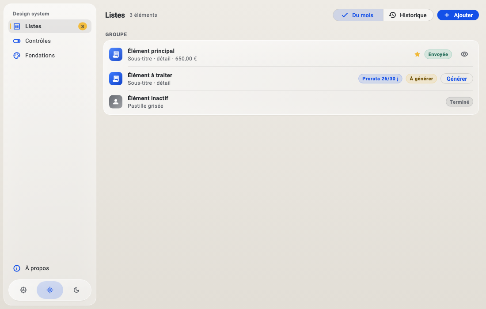

# ColDay Design System

Design system commun des applis publiées sous le nom de ColDay : règles UX/UI, valeurs de design (tokens)
et code de thème réutilisable.

| Dossier | Contenu |
|---|---|
| [`docs/`](docs/regles-ux-ui.md) | Règles UX/UI communes à toutes les applis (principes, couleurs, typographie, mise en page, composants, rédaction). |
| [`tokens/`](tokens/tokens.json) | Valeurs de design, **source unique** : couleurs, opacités, flou, rayons, tailles de texte, tailles, espacements. |
| [`flutter/`](flutter/README.md) | Package Flutter `vb_design` : thème, composants en verre, coquille d'appli façon Finder, intégration fenêtre macOS, galerie. |
| `web/` | Plus tard : thème web (variables CSS) généré depuis les mêmes tokens. |

Rendu : style **Liquid Glass sobre**, proche du Finder de macOS, compact, thème
**Auto / Clair / Sombre** (Auto par défaut).



## Utiliser dans une appli Flutter

```yaml
dependencies:
  vb_design:
    git:
      url: https://github.com/vince4012/design-system.git
      path: flutter
      ref: v0.1.0
```

Mise en place : voir [`flutter/README.md`](flutter/README.md).

## Faire évoluer

1. Modifier la valeur dans `tokens/tokens.json` (ou une règle dans `docs/`).
2. Régénérer chaque techno (`cd flutter && dart run tool/generate_tokens.dart`).
3. Vérifier la galerie et ses captures, publier une nouvelle version (tag `vX.Y.Z`),
   puis monter la version dans les applis.

Détails pour la maintenance : [MAINTENANCE.md](MAINTENANCE.md).
